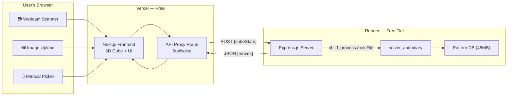

# Rubik's Cube Solver — Full-Stack Web App

Build a web interface for the C++ Rubik's Cube solver with manual color input, webcam scanning, and image upload, then deploy it online.

---

## Progress Tracker

### Phase 3A: Prepare C++ Solver for API Use

| Task | Status |
|------|--------|
| Add `setColor()` declaration to `RubiksCube.h` | ✅ Done |
| Implement `setColor()` in `RubiksCube3dArray.cpp` | ✅ Done |
| Implement `setColor()` in `RubiksCube1dArray.cpp` | ✅ Done |
| Implement `setColor()` in `RubiksCubeBitboard.cpp` | ✅ Done |
| Create `solver_api.cpp` CLI entry point | ✅ Done |
| Update `CMakeLists.txt` with `solver_api` target | ✅ Done |
| Build & test `solver_api` | ✅ Done |

### Phase 3B: Next.js Frontend

| Task | Status |
|------|--------|
| Initialize Next.js app in `web/` | ✅ Done |
| `web/src/lib/cubeState.ts` — state, validation, moves | ✅ Done |
| `web/src/components/ManualColorPicker.tsx` | ✅ Done |
| `web/src/components/RubiksCube3D.tsx` | ✅ Done |
| `web/src/components/SolutionPlayer.tsx` | ✅ Done |
| `web/src/app/api/solve/route.ts` — API proxy | ✅ Done |
| `web/src/app/page.tsx` — landing page | ✅ Done |
| `web/src/app/solve/page.tsx` — solver page | ✅ Done |
| Dark theme + responsive layout | ✅ Done |

### Phase 3C: Express Backend

| Task | Status |
|------|--------|
| `server/package.json` | ✅ Done |
| `server/index.js` — POST /api/solve + GET /health | ✅ Done |
| `server/Dockerfile` — multi-stage (gcc:13 + node:20-slim) | ✅ Done |

### Phase 3D: Deployment

| Task | Status |
|------|--------|
| Push to GitHub | ✅ Done |
| Deploy frontend to Vercel (root dir: `web/`) | ⬜ Todo |
| Deploy backend to Render (Docker, context: repo root) | ⬜ Todo |
| Set `RENDER_API_URL` env var on Vercel | ⬜ Todo |
| End-to-end test on live URLs | ⬜ Todo |

> **Local integration complete** — all 3A, 3B, 3C milestones verified locally. Next step: deploy (Phase 3D).

---

## Decisions Made

| Decision | Choice | Rationale |
|---|---|---|
| **Deployment** | Split: Vercel (frontend) + Render (backend) | Vercel CDN = instant page load. Only the "Solve" action hits Render, so the ~30s cold start feels like computation, not a broken site. |
| **3D Rendering** | CSS 3D Transforms (no Three.js) | The cube is flat-colored squares — no need for WebGL/lighting/textures. CSS 3D is 0KB added, renders crisply, and animates smoothly. |
| **C++ Integration** | `child_process.execFile()` calling `solver_api` binary | Much simpler than `node-addon-api`. No native compilation on deployment servers. Just compile the binary in Docker. |
| **Input Methods** | Manual Color Picker (MVP), then Webcam + Image Upload | Three ways to input cube state; manual is simplest for MVP. |
| **Cube State Format** | 54-char string, face order U L F R B D, chars W G R B O Y | Matches `RubiksCube1dArray` indexing: `face*9 + row*3 + col`. Solved = `WWWWWWWWWGGGGGGGGGRRRRRRRRRBBBBBBBBBOOOOOOOOOYYYYYYYYY` |

---

## Architecture



**Data Flow:**
1. User inputs cube state via manual picker / webcam / image upload.
2. Frontend validates the state (each color exactly 9 times, correct centers).
3. Frontend sends a 54-char cube state string to Next.js API proxy route.
4. Proxy forwards it to the Render backend (keeps the URL server-side, no CORS issues).
5. Express calls `solver_api` binary via `child_process.execFile()`.
6. Solver loads the pattern database, solves the cube, prints moves to stdout.
7. Express parses stdout and returns JSON: `{ moves: ["F", "R'", "U2", ...] }`.
8. Frontend animates/displays the solution on the 3D cube.

---

## Time Estimates

| Phase | Scope | Estimate |
|-------|-------|----------|
| 3A | C++ API prep | ~2h |
| 3B MVP | Manual picker + 3D cube + solution player + pages | ~24h |
| 3B post-MVP | Webcam + image upload + animations + polish | ~24h |
| 3C | Express backend + Dockerfile | ~3.5h |
| 3D | Vercel + Render deployment | ~2h |
| **MVP Total** | 3A + 3B-MVP + 3C + 3D | **~31h (~5–7 days)** |
| **Full Total** | Everything | **~55h (~10–14 days)** |

---

## Phase 3A: C++ Solver API Prep (Detailed)

### setColor() Implementation

The 54-char string convention: face order `U(0) L(1) F(2) R(3) B(4) D(5)`, 9 chars each, row-major (row*3+col). Solved cube = `WWWWWWWWWGGGGGGGGGRRRRRRRRRBBBBBBBBBOOOOOOOOOYYYYYYYYY`.

**`RubiksCube3dArray.cpp`** — simple char store:
```cpp
void setColor(FACE face, unsigned row, unsigned col, COLOR color) override {
    cube[(int)face][row][col] = getColorLetter(color);
}
```

**`RubiksCube1dArray.cpp`** — uses existing `getIndex()` helper:
```cpp
void setColor(FACE face, unsigned row, unsigned col, COLOR color) override {
    cube[getIndex((int)face, (int)row, (int)col)] = getColorLetter(color);
}
```

**`RubiksCubeBitboard.cpp`** — bit manipulation with `arr[3][3]` index mapping. Center (idx==8) is implicit, skip it:
```cpp
void setColor(FACE face, unsigned row, unsigned col, COLOR color) override {
    int idx = arr[row][col];
    if (idx == 8) return;
    uint64_t clr = 1ULL << (int)color;
    bitboard[(int)face] = (bitboard[(int)face] & ~(one_8 << (8 * idx))) | (clr << (8 * idx));
}
```

### solver_api.cpp

CLI: `./solver_api "<54-char-string>" [db-path]`

Validation layers:
1. String length == 54
2. All chars in {W,G,R,B,O,Y} (case-insensitive)
3. Each color appears exactly 9 times
4. Center facelets: positions 4,13,22,31,40,49 must be W,G,R,B,O,Y respectively

On success: prints space-separated moves to stdout, exit 0.
On error: prints message to stderr, exit 1.

### CMakeLists.txt

Extract shared sources into `COMMON_SOURCES`, add `solver_api` as second executable target (same sources as `rubiks_cube_solver`, entry point = `solver_api.cpp`).

---

## Phase 3B: Next.js Frontend (Detailed)

### Build Order

1. **`cubeState.ts`** — data backbone; everything else depends on it
2. **`ManualColorPicker.tsx`** — simplest input method
3. **`RubiksCube3D.tsx`** — visual display
4. **`SolutionPlayer.tsx`** — solution display
5. **`api/solve/route.ts`** — backend proxy
6. **`page.tsx`** + **`solve/page.tsx`** — pages
7. **Dark theme + layout polish**

### cubeState.ts

Key types and functions:
```typescript
type Color = 0 | 1 | 2 | 3 | 4 | 5;  // W G R B O Y
type CubeState = Color[];              // length 54
// index = face*9 + row*3 + col

createSolvedState(): CubeState
serialize(state): string              // → 54-char "WWWGG..."
deserialize(str): CubeState
validate(state): { valid: boolean, errors: string[] }
setCell(state, face, row, col, color): CubeState
applyMove(state, move): CubeState     // port from RubiksCube3dArray.cpp
```

`applyMove()` must port ALL 6 face moves (F/B/U/D/L/R) and `rotateFace()` from `Model/RubiksCube3dArray.cpp` exactly, or the solution player will show wrong cube states.

### RubiksCube3D.tsx

CSS 3D approach:
- Container: `perspective: 800px`
- Scene: `transform-style: preserve-3d`, receives drag rotation
- 6 face groups positioned with `rotateX/Y` + `translateZ(75px)`
- Each sticker: 45px square div colored by CubeState value
- Drag-to-rotate: track mouse/touch delta → update scene rotation

Color hex: W=#FFFFFF, G=#00D25A, R=#FF3232, B=#3264FF, O=#FF8C00, Y=#FFE500

### SolutionPlayer.tsx

Precompute `cubeStates[i]` = state after applying moves[0..i-1] (using applyMove).
Controls: ⏮ prev ▶/⏸ play ⏭ next — auto-advance every 1s when playing.

---

## Phase 3C: Express Backend (Detailed)

### server/index.js

```javascript
POST /api/solve
  Body: { cubeState: "WWWGR...OYYYB" }
  Response: { success: true, moves: ["F", "R'", "U2"], moveCount: 3 }
  Errors: { success: false, error: "Invalid cube state" }

GET /health → { status: "ok" }
```

Uses `execFile` (not `exec`) — no shell injection risk. 30s timeout. Database path configurable via `DB_PATH` env var.

### server/Dockerfile

Multi-stage:
1. `FROM gcc:13 AS builder` — copy C++ sources, run cmake Release build, produce `solver_api` binary
2. `FROM node:20-slim` — copy binary + 48MB DB + server files, `npm ci --production`

Docker build context = repo root (Dockerfile needs `Model/`, `Solver/`, etc.).

---

## Phase 3D: Deployment (Detailed)

### Vercel
- Root directory: `web/`
- Env var: `RENDER_API_URL=https://your-app.onrender.com`

### Render
- Runtime: Docker
- Dockerfile path: `server/Dockerfile`
- Build context: `.` (repo root)
- `PORT` env var injected automatically by Render

### Cold Start UX
- On solve page mount: ping `/health` to pre-warm the container
- Progressive loading states: "Connecting..." → "Waking up server..." → "Solving..."

---

## Key Risks

| Risk | Impact | Mitigation |
|------|--------|------------|
| Bitboard `setColor()` bit math bug | Solver produces wrong results | Test: set known state → call getColor() every cell → compare |
| TypeScript `applyMove()` diverges from C++ | Wrong cube states in solution player | Test same scramble in both, compare final states |
| 48MB DB on Render 512MB free tier | OOM crash | Monitor; can use mmap if needed |
| Unsolvable cube input (no parity check) | IDA* runs forever | 30s backend timeout catches it |
| Render cold start perceived as broken | User confusion | Progressive loading + health ping pre-warm |

---

## Verification Plan

### Phase 3A
```bash
cmake -B build && cmake --build build
.\build\Debug\solver_api.exe "WWWWWWWWWGGGGGGGGGRRRRRRRRRBBBBBBBBBOOOOOOOOOYYYYYYYYY"
# → (empty line, already solved)
.\build\Debug\solver_api.exe "INVALID"
# → error message, exit 1
```

### Phase 3B + 3C (local)
```bash
cd web && npm run dev        # localhost:3000
node server/index.js         # localhost:3001
```

### End-to-End
- Live URL: manual input → solve → solution displayed
- Cold start: first request shows progressive loading
- Invalid input: error shown inline
